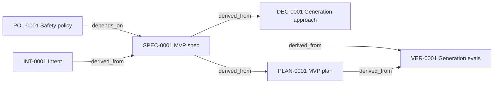

# Example: MCP App Builder SDLC

**Version:** 0.1.0 · **Generated:** 2026-11-22 · **Generator:** `skills/agentic-sdlc-bootstrap` (profile `software`, mode `lite`)

A deliberately small agentic SDLC for building "Lovable for MCP apps": a product where a person describes an
MCP app in natural language and gets a tested, previewable, deployable MCP server. It doubles as a worked example
and a real test of the bootstrap skill.

## Document chain


Key: arrows point from the upstream document to the document that pins it. All documents are `0.1.0` drafts awaiting human approval.

## Lifecycle

Plan (INT, POL) -> Design (SPEC, DEC) -> Build (PLAN) -> Test (VER). Deploy and Maintain artifacts (REV, REL, OPS)
are not created yet; templates are in `sdlc/_templates/`. Gates are in `sdlc/governance/gates.md`.

## Use it

```bash
python sdlc/_tools/validate_docs.py sdlc   # integrity, links, pins, diagrams
```
