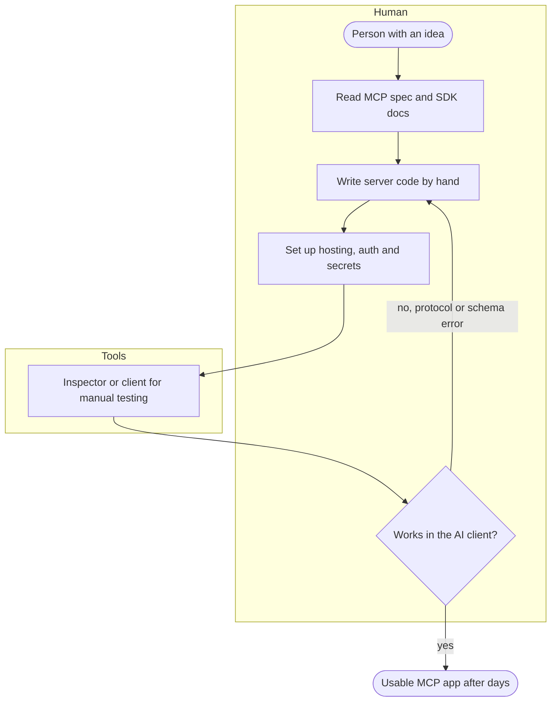
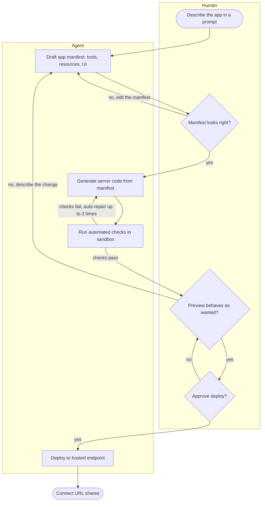

# Intent: MCP App Builder
<!-- Root of the chain. Every spec, plan and release for the product traces back to this intent. -->

## Problem
People who want an AI assistant to use their data or services need an MCP (Model Context Protocol) server, and
increasingly an *MCP App* (a tool that also returns an interactive UI rendered inside the chat client). Building
one by hand needs protocol knowledge, TypeScript or Python, hosting, auth and testing. Non-engineers cannot do it
and engineers lose hours on boilerplate. "Lovable for websites" exists; nothing equivalent exists for MCP apps.

**Purpose:** shows how a person gets an MCP app today and where the effort and failures concentrate.

Key: diamond = decision; rounded = start or end; the loop on failure is where most time is lost.
- The path is entirely manual and requires an engineer.
- Failures are found late, only when a real client calls the server.

## Proposed outcome
A person describes an MCP app in natural language and gets, within minutes, a tested, previewable and deployable
MCP server (optionally with an interactive UI), then iterates on it by chatting. Success means: first working
preview in under 5 minutes for a simple app, at least 80% of prompts in the eval set produce a server that passes
protocol checks on the first attempt, and a deployed app can be connected to a standard MCP client by URL.

**Purpose:** shows the target flow, where the agent does the work and where the human must decide.

Key: diamond = human gate; rectangles = agent steps; every failure edge returns to an earlier step.
- The human approves the manifest before any code is written, then the preview, then the deploy.
- Automated checks gate the preview, so humans never see a server that fails the protocol.

## Affected users and systems
- Primary users: non-engineers and "citizen builders" who want AI-connected tools.
- Secondary users: developers who want a head start and will export the code.
- Systems: LLM provider, code sandbox, hosting platform, secret vault, MCP clients used for testing.

## Constraints
- Generated servers must follow the current MCP specification and the official SDKs.
- Generated code must comply with POL-0001 (safety of generated servers).
- Out of scope for the MVP: marketplace of apps, billing, team collaboration, non-HTTP transports.
- Budget and deadline are not defined yet (see open questions).

## Open questions
- [ ] Which hosting target does the MVP deploy to (own platform, Cloudflare, other)?
- [ ] Is TypeScript the only generated language for the MVP? (proposed: yes, see DEC-0001)
- [ ] Which MCP clients must the preview support for UI rendering?
- [ ] Pricing and usage limits for generation and hosting.

## Related documents
- Derived from: _none (root document)_
- Depended on by: [SPEC-0001](../../02-design/specs/SPEC-0001-mcp-app-builder-mvp.md)
- Lifecycle map: [sdlc/README.md](../../README.md)

## Changelog
| version | date | author | change |
|---|---|---|---|
| 0.1.0 | 2026-11-22 | Rafa | Initial draft |
