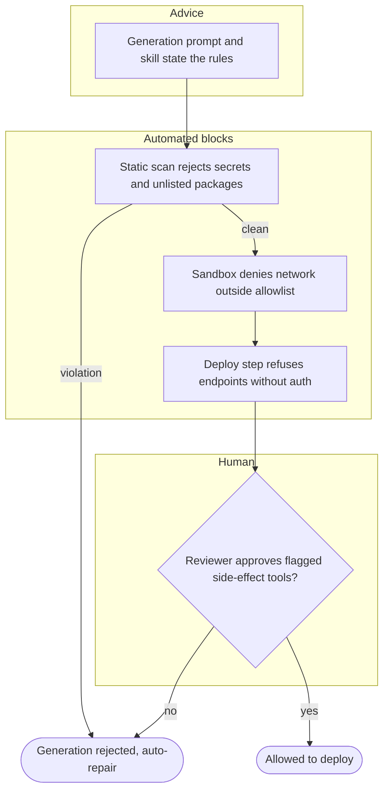

# Policy: Generated MCP server safety
<!-- Rules every generated MCP server and every agent that generates one must obey. -->

## Statement
1. **No secrets in code.** API keys and tokens are injected at runtime from the vault; generated source never contains them.
2. **Sandboxed execution.** Generated code runs only in an isolated sandbox with a network egress allowlist derived from the manifest.
3. **Side-effect confirmation.** Tools that write, delete or spend are annotated as such in the manifest and require explicit client-side user confirmation.
4. **Dependency allowlist.** Generated servers may use only the official MCP SDK and packages from an approved list.
5. **UI isolation.** Interactive UI resources are served for rendering in a sandboxed frame with a restrictive content security policy and no access to the host page.
6. **Authenticated endpoints.** Every deployed endpoint requires authentication; there are no anonymous deployments.

## Scope
Applies to the builder product, its generation agents, and every server produced by it. Does not apply to the SDLC documents themselves.

## Owner and source of truth
Owner: Rafa (product and security). This document is the source of truth; later it can be encoded as a skill for the generation agent.

## Enforcement
**Purpose:** shows the layers that enforce the policy, from advice to hard blocks, and what happens on violation.

Key: rectangles = automated or advisory layer; diamond = human check; rounded = outcome.
- Advice alone is never relied upon: rules 1, 2, 4 and 6 are enforced by code.
- Rule 3 needs a human because intent of a tool cannot be inferred reliably.

## Related documents
- Depended on by: [SPEC-0001](../../02-design/specs/SPEC-0001-mcp-app-builder-mvp.md)

## Changelog
| version | date | author | change |
|---|---|---|---|
| 0.1.0 | 2026-11-22 | Rafa | Initial draft |
