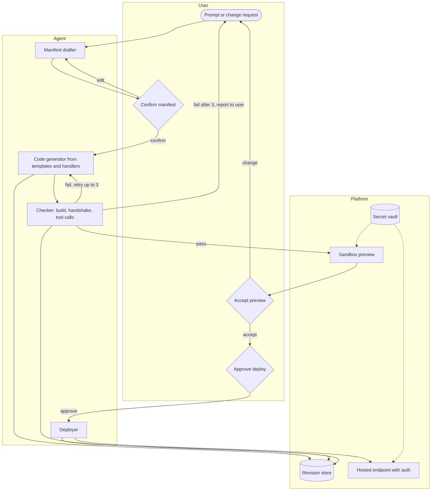

# Spec: MCP App Builder MVP
<!-- Requirements and design in one document. Constrained by POL-0001. -->

## Summary
A web product where a user types what MCP app they want. An agent drafts a structured manifest, the user
confirms it, the agent generates a TypeScript MCP server (with optional UI resources), verifies it automatically
in a sandbox, shows a live preview, supports iteration by chat, and deploys it to an authenticated URL.

## Requirements
- **R-1** The system shall convert a natural-language prompt into a manifest (name, tools with input schemas, resources, optional UI per tool, required secrets) and show it for user confirmation before generating code.
- **R-2** The system shall generate a TypeScript MCP server from the confirmed manifest using the official MCP SDK.
- **R-3** The system shall support an optional interactive UI resource per tool (MCP Apps style) rendered in a sandboxed preview.
- **R-4** The system shall run automated checks on every generated revision: build, protocol handshake, tool listing, and one call per tool with sample arguments; failures trigger up to 3 automatic repair attempts.
- **R-5** The system shall provide a live preview connected to the sandboxed server and accept chat instructions that create a new revision.
- **R-6** The system shall deploy a revision to a hosted HTTPS endpoint with authentication and return a connect URL.
- **R-7** The system shall keep all secrets in a vault and inject them at runtime; secrets never appear in generated code or logs.
- **R-8** The system shall store for each revision the prompt, manifest, code, check results and approver, so any deployed app is traceable.
- **R-9** The user shall be able to roll back a deployed app to any previous revision.

## Design
Manifest-first generation (see [DEC-0001](../decisions/DEC-0001-generation-approach-and-sandbox.md)): the manifest is
the contract between the human and the agent, so the human reviews a small structured object, not source code.

**Purpose:** shows the end-to-end system flow, who acts at each step, and where failures loop back.

Key: diamond = human gate; cylinder = store; dotted arrow = runtime secret injection.
- The revision store is written at every stage so R-8 and R-9 are satisfied by construction.
- Secrets flow only from the vault into running processes, never through the generator.

## Policy compliance
- POL-0001 rule 1 and R-7: secrets are vault-only; the static scan blocks literal credentials.
- POL-0001 rules 2 and 4: preview runs in the sandbox; dependency allowlist enforced during build (R-4).
- POL-0001 rule 3: manifest marks side-effect tools; the confirmation gate (R-1) shows them highlighted.
- POL-0001 rule 5: UI resources (R-3) are served to a sandboxed frame with restrictive CSP.
- POL-0001 rule 6: R-6 forbids anonymous deployments.

## Areas of concern
- Prompt injection through data returned by user-connected services: generated tools must treat tool output as untrusted.
- Generated UI may attempt exfiltration; CSP and sandbox must be verified (see VER-0001, C-6).
- Cost per generation attempt is unknown; repair loop is capped at 3 to bound it.
- MCP Apps and client UI support are evolving; keep the UI layer behind an adapter.

## Acceptance criteria
- R-1: a manifest is shown and no code exists before confirmation.
- R-2, R-4: a generated server passes build and handshake in the sandbox for at least 80% of the eval prompts on first attempt.
- R-3: UI preview renders and cannot reach outside origins.
- R-5: a chat change yields a new revision number and a visible diff of the manifest.
- R-6: connect URL works from a standard MCP client and rejects unauthenticated calls.
- R-7: scanning code, logs and revision store finds no secret values.
- R-8, R-9: rolling back restores the exact earlier revision and records who did it.

## Related documents
- Derived from: [INT-0001@0.1.0](../../01-plan/intents/INT-0001-mcp-app-builder.md)
- Depends on: [POL-0001@0.1.0](../../01-plan/policies/POL-0001-generated-mcp-server-safety.md)
- Decisions: [DEC-0001](../decisions/DEC-0001-generation-approach-and-sandbox.md)

## Changelog
| version | date | author | change |
|---|---|---|---|
| 0.1.0 | 2026-11-22 | Rafa | Initial draft |
