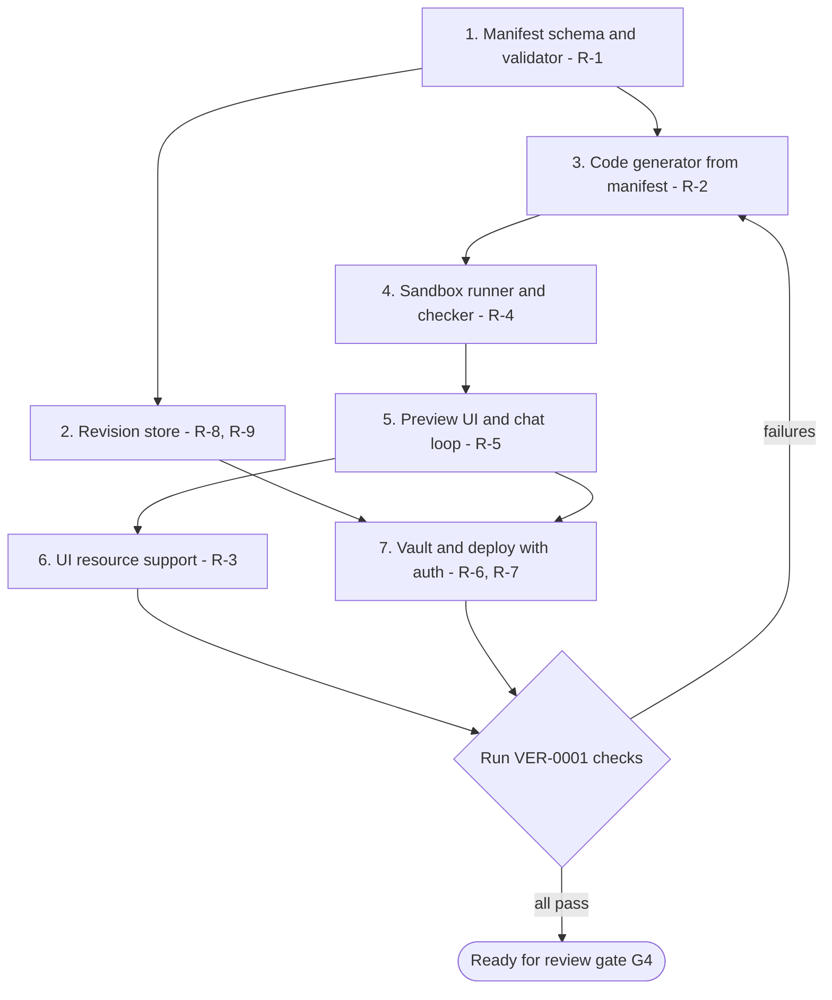

# Plan: MVP implementation plan
<!-- Reviewed by a human before any code is written (gate G3). -->

## Objective
Build the smallest end-to-end slice of SPEC-0001: prompt to manifest to generated server to checks to preview
to deploy, with revision history. Covers R-1 to R-9.

## Steps
**Purpose:** shows the build order, dependencies between steps, and where verification runs.

Key: rectangles = build steps with the requirements they cover; diamond = verification checkpoint.
- Steps 1 to 5 form the walking skeleton; each ends with its own automated check.
- Steps 6 and 7 can proceed in parallel once the preview works.
- Any failure at the checkpoint returns to the generator, the most common cause.

1. Define the manifest JSON schema and validator.
2. Implement the revision store with rollback.
3. Implement the generator (templates plus handler generation).
4. Implement the sandbox runner and the checker (build, handshake, tool calls, static scan).
5. Build the preview UI and chat iteration loop.
6. Add UI resource support behind an adapter.
7. Add vault integration and authenticated deploy.

## Deliverables touched
Manifest schema, generator service, sandbox runner, checker, web app, deploy service, eval set (see VER-0001).

## Risks
- Hosting target undecided (INT-0001 open question): mitigate by isolating deploy behind an interface.
- Repair loop cost and latency: cap at 3 attempts and track cost per generation.
- Client differences in rendering UI resources: support one reference client first.

## Verification
Run all checks in [VER-0001](../../04-test/verification/VER-0001-mvp-generation-evals.md) after step 7 and the per-step checks along the way.

## Rollback
Each step ships behind a feature flag; revert the flag or the commit. Deployed user apps are unaffected because they run from stored revisions.

## Related documents
- Derived from: [SPEC-0001@0.1.0](../../02-design/specs/SPEC-0001-mcp-app-builder-mvp.md)

## Changelog
| version | date | author | change |
|---|---|---|---|
| 0.1.0 | 2026-11-22 | Rafa | Initial draft |
