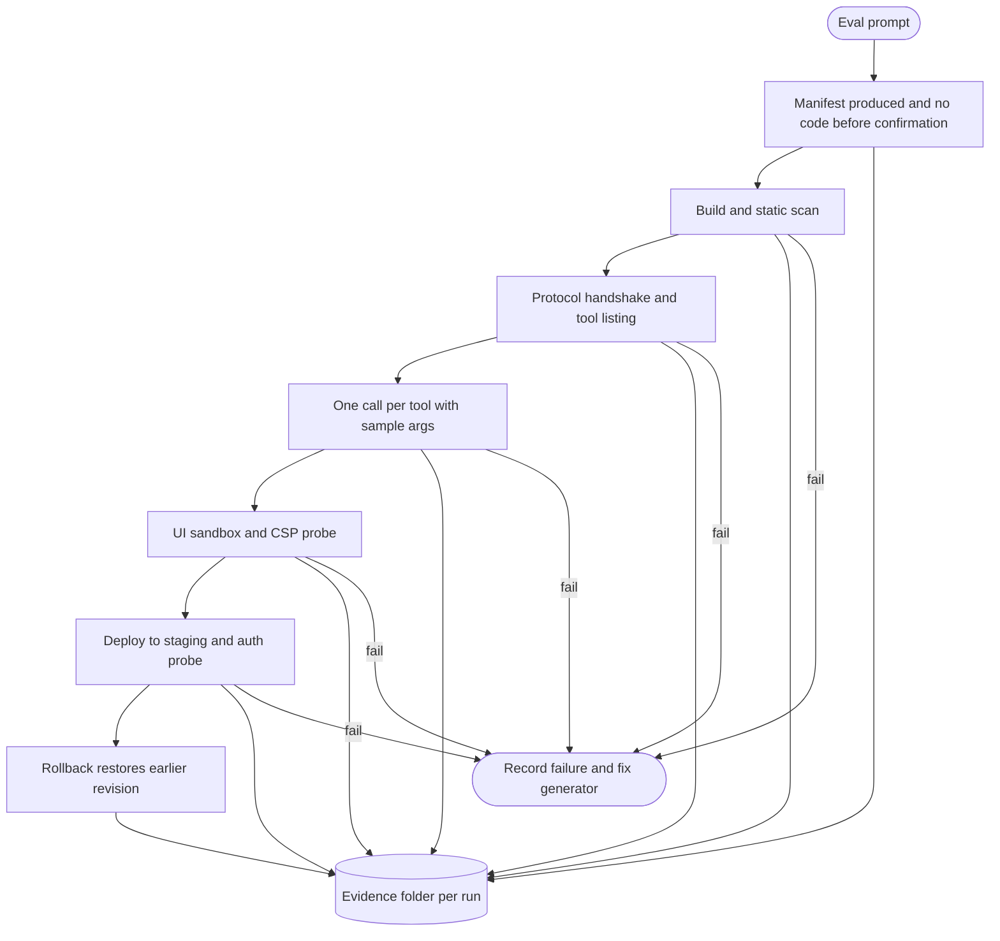

# Verification: MVP generation evals
<!-- The verifier is independent of the builder. Results stay empty until checks are run. -->

## Scope
All requirements R-1 to R-9 of SPEC-0001. The eval set is 20 prompts (10 simple, 5 with UI, 5 adversarial) kept
in the repository and versioned with this document.

## Checks
**Purpose:** shows the order in which checks run for each eval prompt and where evidence is stored.

Key: rectangles = checks; cylinder = evidence store; every failing check ends in a recorded failure.

| id | Check | Covers | Pass condition |
|---|---|---|---|
| C-1 | Manifest-before-code | R-1 | No generated file exists before confirmation |
| C-2 | Build and scan | R-2, R-7 | Build succeeds; no secret literals or unlisted packages |
| C-3 | Handshake | R-2, R-4 | Initialize and tool listing succeed with SDK client |
| C-4 | Tool calls | R-4 | Each tool returns a valid result for sample args; 80% first-attempt pass overall |
| C-5 | Chat revision | R-5, R-8 | New revision number and manifest diff recorded |
| C-6 | UI isolation | R-3 | UI renders; requests to foreign origins are blocked |
| C-7 | Deploy auth | R-6 | Unauthenticated call rejected; authenticated call works |
| C-8 | Secret hygiene | R-7 | No secret values in code, logs or revision store |
| C-9 | Rollback | R-9 | Restored revision byte-identical to the original |

## Evidence
Per run: manifest, generated code hash, check logs and transcript, stored under the revision id. Location to be fixed in PLAN-0001 step 2.

## Results
_Not run yet._ Record pass/fail per check and prompt here, with the date and the build under test.

## Related documents
- Derived from: [SPEC-0001@0.1.0](../../02-design/specs/SPEC-0001-mcp-app-builder-mvp.md), [PLAN-0001@0.1.0](../../03-build/plans/PLAN-0001-mvp-implementation-plan.md)

## Changelog
| version | date | author | change |
|---|---|---|---|
| 0.1.0 | 2026-11-22 | Rafa | Initial draft |
