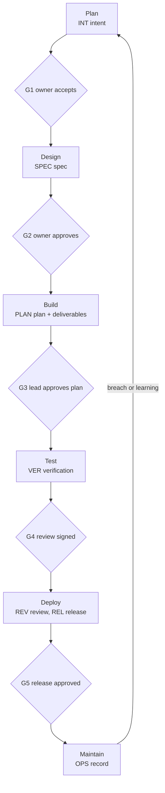

# MCP App Builder - lifecycle documents
<!-- Entry point for humans. Generated by the agentic-sdlc-bootstrap skill; safe to edit. -->

Profile: **software** | Mode: **lite** | Created: 2026-11-22

## How it works
Each stage ends by committing one artifact; the next stage starts by reading it. Every document has an id,
a version and pinned links to its upstream documents. Humans approve at the gates in `governance/gates.md`.

| # | Stage | Autonomy |
|---|---|---|
| 1 | Plan (`plan`) | gated |
| 2 | Design (`design`) | gated |
| 3 | Build (`build`) | gated |
| 4 | Test (`test`) | gated |
| 5 | Deploy (`deploy`) | gated |
| 6 | Maintain (`maintain`) | gated |

## Lifecycle at a glance
Purpose: shows the loop, the artifact each stage commits, and where a human must approve.


Key: diamonds = human approval gates (details in `governance/gates.md`).
- Each stage commits one artifact that the next stage reads.
- Maintain closes the loop by writing the next intent.

## Folders
- `01-plan/` intents and policies - `02-design/` specs and decisions - `03-build/` plans
- `04-test/` verification - `05-deploy/` reviews and releases - `06-maintain/` operations records
- `workstreams/` per-workstream stages (program profile)
- `_templates/` document templates - `_tools/` validator and helpers - `.index/` GENERATED graph and impact reports

## Everyday commands
```bash
python sdlc/_tools/new_doc.py sdlc spec "Checkout redesign" --derived-from INT-0001@1.0.0
python sdlc/_tools/bump.py sdlc SPEC-0001 minor --note "Added R-4"
python sdlc/_tools/validate_docs.py sdlc          # add --git in CI to catch silent edits
```
View the dependency graph: open `.index/graph.mmd` in any Mermaid renderer. What depends on what: `.index/impact.md`.
