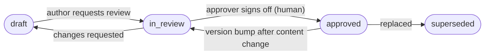

# Gates
<!-- A gate is the human decision point that ends a stage. Fill approver names; keep evidence concrete. -->

| Gate | Artifact approved | Approver (role/name) | Evidence required | Triggers next |
|---|---|---|---|---|
| G1 | INT accepted | Rafa | Problem, outcome, constraints, open questions answered or deferred | Design pass |
| G2 | SPEC approved | Rafa | Requirements numbered; policy compliance filled; concerns reviewed | Planning |
| G3 | PLAN approved | _name_ | Risks, verification and rollback present | Execution |
| G4 | VER passed + REV signed | _name_ | All covered requirements verified; findings resolved | Release |
| G5 | REL approved | _name_ | Rollback path confirmed | Rollout |
| G6 | OPS reviewed | _name_ | Cause and follow-up intent recorded | New intent (loop) |

## Approval flow
Purpose: shows how any artifact moves from draft to approved and what happens on rejection or later change.

- Only a human approver moves a document to `approved`.
- Editing approved content always creates a new version that re-enters review.

## Rules
- Status `approved` is set only by the named human approver, in a separate commit/PR approval from content edits.
- Raise a stage's autonomy tier (`sdlc.config.json` -> `autonomy`) only after its gate, checks and rollback path exist.
- Actions that publish, delete or spend money require human approval regardless of tier.
