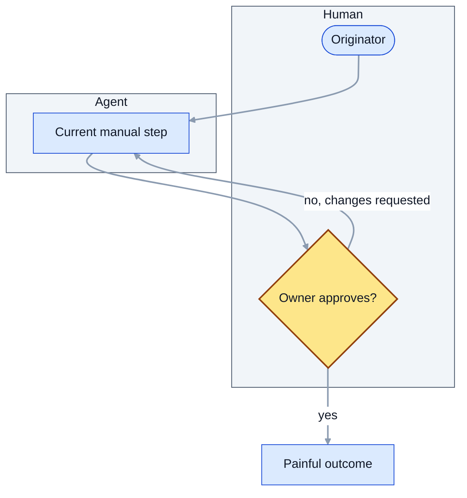
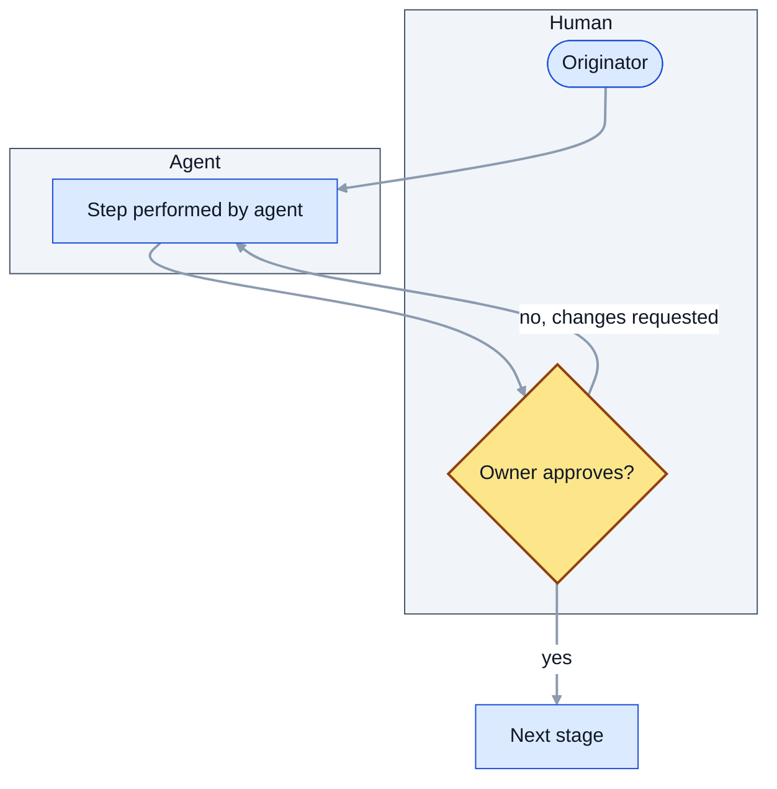

# Intent: {{TITLE}}
<!-- An intent captures what is wanted, why and under which constraints, in the originator's own words.
     It is the root of the chain: every spec, plan and release traces back to an intent. -->

## Problem
<!-- What can people not do today? Who is affected? Evidence or numbers if available. -->

<!-- DIAGRAM REQUIRED (see references/diagramming-guide.md): how the work happens TODAY (current process), including the pain points.
     Keep the purpose line, label every decision edge, show roles and gates, add a legend, then 2-4 bullets narrating the key path. Replace the placeholder nodes. -->
**Purpose:** _one sentence: what this diagram shows and the question it answers._

Key: blue diamond = human approval gate; arrows are labelled with the outcome.
- _Narrate the main path._
- _Narrate the exception or failure path._

## Proposed outcome
<!-- What better looks like. Describe results, not solutions. Include how success will be recognised. -->

<!-- DIAGRAM REQUIRED (see references/diagramming-guide.md): how the work should happen AFTER the change (proposed process).
     Keep the purpose line, label every decision edge, show roles and gates, add a legend, then 2-4 bullets narrating the key path. Replace the placeholder nodes. -->
**Purpose:** _one sentence: what this diagram shows and the question it answers._

Key: blue diamond = human approval gate; arrows are labelled with the outcome.
- _Narrate the main path._
- _Narrate the exception or failure path._

## Affected users and systems
<!-- People, teams, systems, documents, processes touched. -->

## Constraints
<!-- Hard limits: legal, budget, deadline, security, brand, technology, "out of scope". -->

## Open questions
<!-- Unknowns that must be answered before design. Do not hide assumptions here as facts. -->
- [ ] _question_

## Related documents
<!-- Mirror the front matter links with relative Markdown links so readers can click through. -->
- Derived from: _none yet_
- Depends on: _none yet_

## Changelog
<!-- Newest row last. Its version must equal the front matter version. scripts/bump.py maintains this. -->
| version | date | author | change |
|---|---|---|---|
| 0.1.0 | {{DATE}} | {{OWNER}} | Initial draft |
