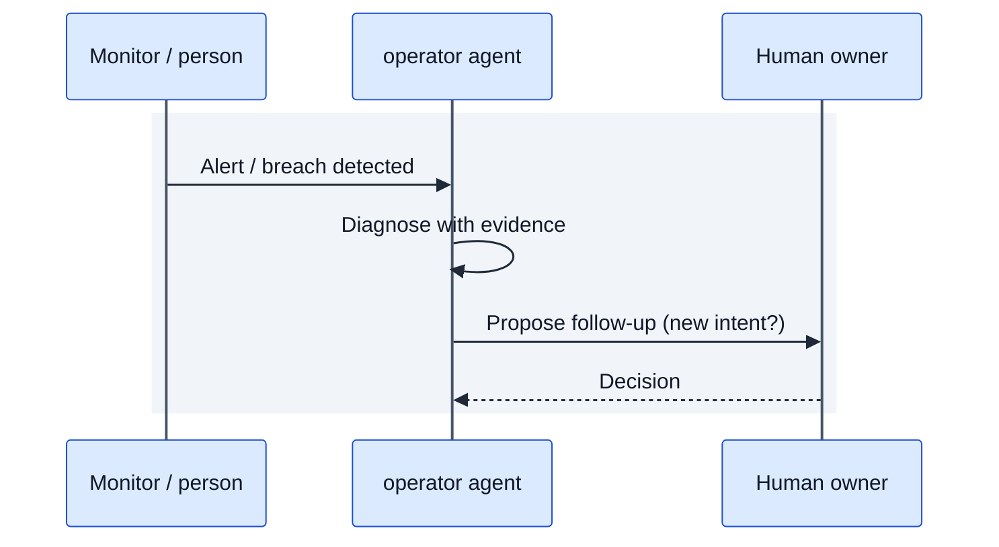

# Operations record: {{TITLE}}
<!-- Incident, metric breach, learning or refresh. If follow-up work is needed, create a new INT that derives from this record. -->

## Trigger
<!-- What happened or which control band was breached, when, detected by whom/what. -->

<!-- DIAGRAM REQUIRED (see references/diagramming-guide.md): the sequence of events from detection to resolution.
     Keep the purpose line, label every decision edge, show roles and gates, add a legend, then 2-4 bullets narrating the key path. Replace the placeholder nodes. -->
**Purpose:** _one sentence: what this diagram shows and the question it answers._

Key: solid arrows = requests; dashed = responses.
- _Narrate detection and diagnosis._
- _State the follow-up decision._

## Diagnosis
<!-- Cause analysis, evidence. -->

## Impact
<!-- Who/what was affected and for how long. -->

## Follow-up
<!-- New intent(s) opened: INT-xxxx. Controls to add (policy, hook, test). -->

## Related documents
<!-- Mirror the front matter links with relative Markdown links so readers can click through. -->
- Derived from: _none yet_
- Depends on: _none yet_

## Changelog
<!-- Newest row last. Its version must equal the front matter version. scripts/bump.py maintains this. -->
| version | date | author | change |
|---|---|---|---|
| 0.1.0 | {{DATE}} | {{OWNER}} | Initial draft |
