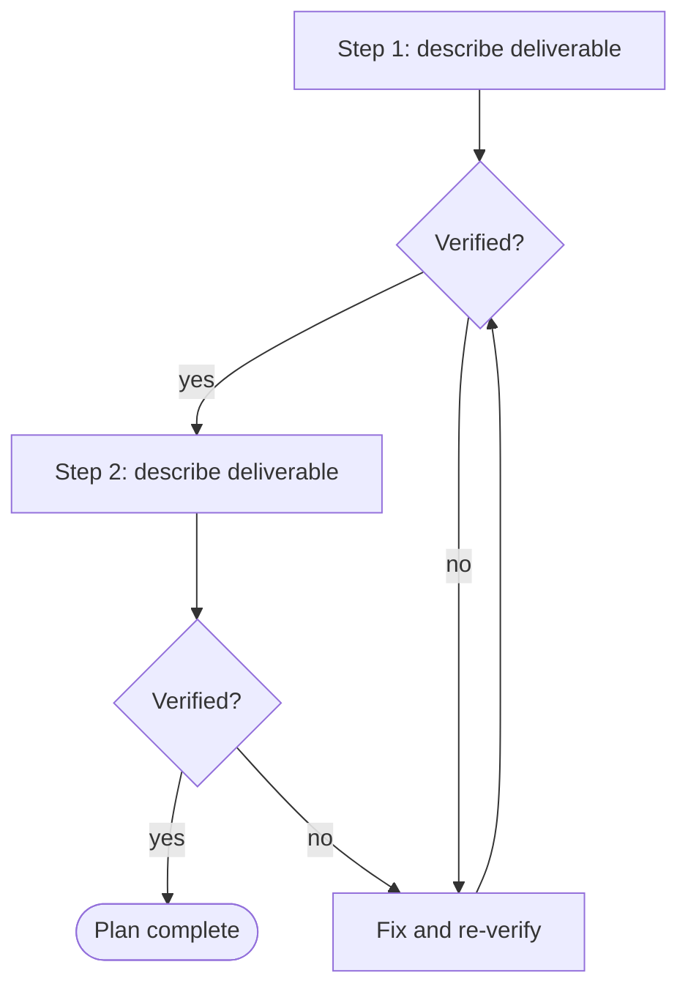

# Plan: {{TITLE}}
<!-- Reviewed BEFORE execution. The reviewer should see the approach first, then details. -->

## Objective
<!-- One paragraph tying back to the spec. -->

## Steps

<!-- DIAGRAM REQUIRED (see references/diagramming-guide.md): order and dependencies of the steps, with verification points.
     Keep the purpose line, label every decision edge, show roles and gates, add a legend, then 2-4 bullets narrating the key path. Replace the placeholder nodes. -->
**Purpose:** _one sentence: what this diagram shows and the question it answers._

Key: diamonds = verification points; the loop shows where rework happens.
- _Narrate the critical path._
- _Narrate what happens when a check fails._
1. _step_ - deliverable touched - how it is verified

## Deliverables touched
<!-- Files, documents, systems, datasets. -->

## Risks
<!-- What could go wrong, how it would be noticed. -->

## Verification
<!-- Commands, checks or evals that prove each step. Reference VER-* when it exists. -->

## Rollback
<!-- How to undo safely. -->

## Related documents
<!-- Mirror the front matter links with relative Markdown links so readers can click through. -->
- Derived from: _none yet_
- Depends on: _none yet_

## Changelog
<!-- Newest row last. Its version must equal the front matter version. scripts/bump.py maintains this. -->
| version | date | author | change |
|---|---|---|---|
| 0.1.0 | {{DATE}} | {{OWNER}} | Initial draft |
