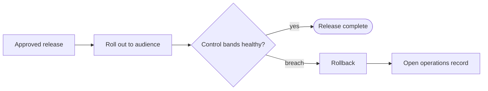

# Release: {{TITLE}}
<!-- Record of what shipped. Cites exact input versions via derived_from. -->

## Contents
<!-- Versions of deliverables released, environment/audience, date. -->

## Approvals
<!-- Who approved, per gate, with links to the approvals. -->

## Rollback path
<!-- Concrete steps and the trigger that invokes them. -->

<!-- DIAGRAM REQUIRED (see references/diagramming-guide.md): rollout steps and the trigger and path for rollback.
     Keep the purpose line, label every decision edge, show roles and gates, add a legend, then 2-4 bullets narrating the key path. Replace the placeholder nodes. -->
**Purpose:** _one sentence: what this diagram shows and the question it answers._

Key: the lower branch is the rollback path.
- _Narrate the trigger that invokes rollback._
- _State who can invoke it._

## Related documents
<!-- Mirror the front matter links with relative Markdown links so readers can click through. -->
- Derived from: _none yet_
- Depends on: _none yet_

## Changelog
<!-- Newest row last. Its version must equal the front matter version. scripts/bump.py maintains this. -->
| version | date | author | change |
|---|---|---|---|
| 0.1.0 | {{DATE}} | {{OWNER}} | Initial draft |
