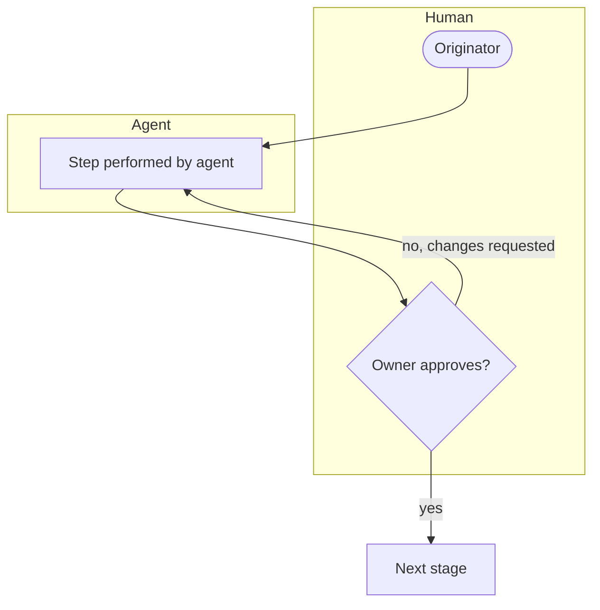

# Spec: {{TITLE}}
<!-- Requirements and design in one working session. Constrained by policies (POL-*) listed in depends_on. -->

## Summary
<!-- Two or three sentences: what will exist when this is done. -->

## Requirements
<!-- Number every requirement R-1, R-2... Each must be testable. Plans and verification cite these ids. -->
- **R-1** _The system/process shall ..._

## Design
<!-- Approach, structure, interfaces, data, workflow. Diagrams welcome (Mermaid). Link decisions (DEC-*). -->

<!-- DIAGRAM REQUIRED (see references/diagramming-guide.md): how the designed solution works end to end, with roles, gates and failure paths.
     Keep the purpose line, label every decision edge, show roles and gates, add a legend, then 2-4 bullets narrating the key path. Replace the placeholder nodes. -->
**Purpose:** _one sentence: what this diagram shows and the question it answers._

Key: diamond = human approval gate; arrows are labelled with the outcome.
- _Narrate the main path._
- _Narrate the exception or failure path._

## Policy compliance
<!-- For each policy in depends_on: how this design complies, or the exception and who approved it. -->

## Areas of concern
<!-- Risks and doubts flagged for human attention: security, compliance, feasibility, ambiguity. -->

## Acceptance criteria
<!-- Observable conditions that make each requirement done. -->

## Related documents
<!-- Mirror the front matter links with relative Markdown links so readers can click through. -->
- Derived from: _none yet_
- Depends on: _none yet_

## Changelog
<!-- Newest row last. Its version must equal the front matter version. scripts/bump.py maintains this. -->
| version | date | author | change |
|---|---|---|---|
| 0.1.0 | {{DATE}} | {{OWNER}} | Initial draft |
