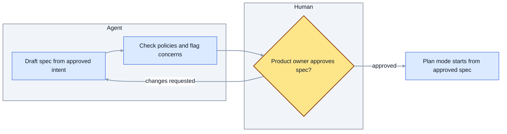
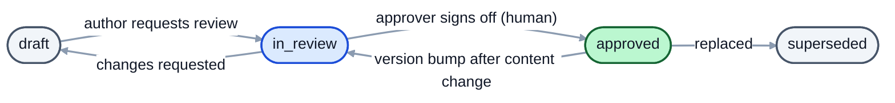
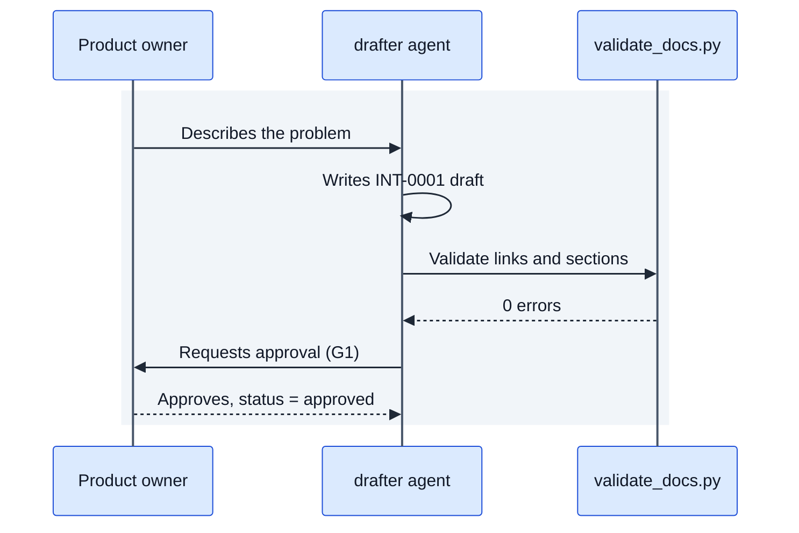

# Diagramming guide (Mermaid)

Rule: whenever you describe or document a process, flow, lifecycle, dependency, state change or interaction, embed a **Mermaid** diagram in the Markdown file itself (a fenced ```` ```mermaid ```` block), never an image or an external file. Text alone hides branches, loops and owners; a diagram lets a reviewer see them at a glance and diff them in git.

A diagram is only useful if it is **descriptive**. Apply the checklist below to every diagram.

## Descriptive checklist
1. **Title and purpose line above the block**: one sentence saying what the diagram shows and the question it answers.
2. **Meaningful labels**: nodes are verbs or states in domain words ("Reviewer approves spec"), never "Step 1" or "Process A".
3. **Label every edge** that is a decision or a condition ("approved", "stale MAJOR", "checks fail").
4. **Show who acts**: use subgraphs or swimlane-style groups for roles (Human, Agent, System).
5. **Show gates, loops and failure paths**, not only the happy path. Mark human approval gates distinctly.
6. **Legend and key** under the block when you use colours, dashed lines or shapes with meaning.
7. **Keep it small**: about 15 nodes maximum. Split into a context view plus detail views.
8. **Link to ids**: use document ids (INT-0001, SPEC-0003) as node labels where a node represents a document.
9. **Text equivalent**: follow the block with 2-4 bullet points narrating the key path, for accessibility and for tools that do not render Mermaid.

## Choosing the diagram type
| You are documenting | Use | Mermaid type |
|---|---|---|
| A process, workflow, decision logic, rollout | Flow with decisions and roles | `flowchart` (TD or LR) |
| Interaction between people, agents and systems over time | Who calls whom, in order | `sequenceDiagram` |
| Lifecycle of a document or object (draft -> approved ...) | States and transitions | `flowchart` with rounded state nodes (not `stateDiagram`, whose labels are unreadable on dark backgrounds) |
| Dependencies and lineage between documents | Directed graph | `flowchart LR` (generated into `.index/graph.mmd`) |
| Schedule, phases, milestones | Timeline of work | `gantt` or `timeline` |
| Data or entity structure | Entities and relations | `erDiagram` |
| Architecture and components | Context and containers | `flowchart` with subgraphs (or `C4Context`) |

## Pattern: process with roles, gates and failure path
Purpose: shows how one stage hands an artifact to the next and where a human must decide.


Key: blue diamond = human approval gate; arrows are labelled with the outcome.
- The agent drafts and self-checks; the human only decides.
- Rejection loops back to drafting, so rework is visible in the audit trail.

## Pattern: document lifecycle (states as a flowchart)

Key: green = approved (immutable); blue = under review; grey = other states.
- Only a human moves a document to approved.
- Changing approved content always loops back through review.

## Pattern: interaction over time (sequenceDiagram)
Use `participant` boxes (not `actor` stick figures: their names are drawn on the page background) and wrap all messages in a light `rect` so text stays readable on any background.


## Readability and contrast (mandatory)
Mermaid's default theme follows the viewer's light or dark mode and mixes with it, which produced unreadable diagrams (dark text on dark fills, thin grey lines). Fix colours explicitly so the diagram reads on **any** background:

1. **Start every diagram with the standard init header** (copy it from the patterns above): `theme: base` plus explicit `lineColor`, `textColor`, `edgeLabelBackground`, `clusterBkg`, `titleColor`.
2. **Every node style sets fill and text colour together.** Use light fills with dark text `#111827`; never set `fill` without `color`.
3. **Edge labels sit on a white pill** (`edgeLabelBackground:#ffffff`) so lines never strike through text; lines are 2px mid-grey `#8b9bb0`, visible on white and near-black.
4. **Use the shared palette**, always with a dark border and text `#111827`:

| Class | Meaning | fill | stroke | Contrast text/fill |
|---|---|---|---|---|
| `agent` | agent or system step | `#dbeafe` | `#1d4ed8` | 14.7:1 |
| `gate` | human decision / approval gate | `#fde68a` | `#92400e` | 13.9:1 |
| `ok` | success, approved, done | `#bbf7d0` | `#166534` | 14.2:1 |
| `risk` | failure, rollback, risk | `#fecaca` | `#991b1b` | 12.0:1 |
| `neutral` | other states and notes | `#f1f5f9` | `#475569` | 16.6:1 |
Never rely on colour alone: gates also use a diamond shape and the legend names each class.
5. **Prefer top-down (`TD`) for long chains** (more than about 6 nodes in a row); wide `LR` diagrams shrink to unreadable text. **Avoid `stateDiagram`** (use a flowchart), avoid `actor` in sequence diagrams (use `participant`), wrap sequence messages in `rect rgb(241, 245, 249)`.
6. **Check it rendered**: view on a dark and a light background before delivering; the validator warns when the init header or a `color:` is missing.

## Rules for writing the Mermaid itself
- Quote labels that contain punctuation: `A["Approve (G1)"]`.
- Declare `classDef` styles once at the bottom; reuse the palette class names across diagrams (`agent`, `gate`, `ok`, `risk`, `neutral`).
- Prefer `flowchart` over the legacy `graph` keyword.
- Validate syntax before finishing. If no renderer is available, re-read the block and check each arrow, bracket and quote; the validator also flags unclosed fences and unknown diagram types (`validate_docs.py` diagram check).

## Where diagrams are mandatory in this system
| Document / file | Required diagram |
|---|---|
| intent | Current process vs proposed process (flowchart) when a workflow is affected |
| spec | Design flow or architecture; state diagram if an object has a lifecycle |
| plan | Step flow with dependencies and verification points |
| verification | How checks run and where evidence is stored |
| release | Rollout and rollback path |
| operations | Timeline or sequence of the incident; follow-up decision flow |
| policy | Enforcement flow (skill advises, hook blocks, CI checks) |
| `sdlc/README.md` | Lifecycle loop and gates |
| `.index/graph.mmd` | Generated dependency graph |
Types listed under `diagram_required` in `sdlc.config.json` get a validator **warning** when they have no ```` ```mermaid ```` block. Decisions (DEC) and reviews (REV) only need one if they describe a process.
