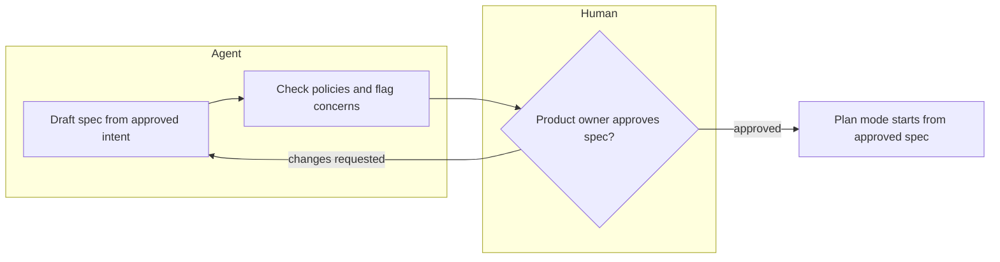
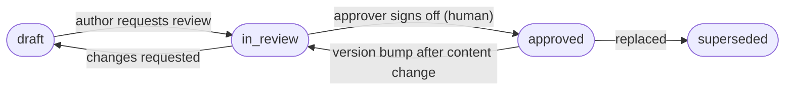
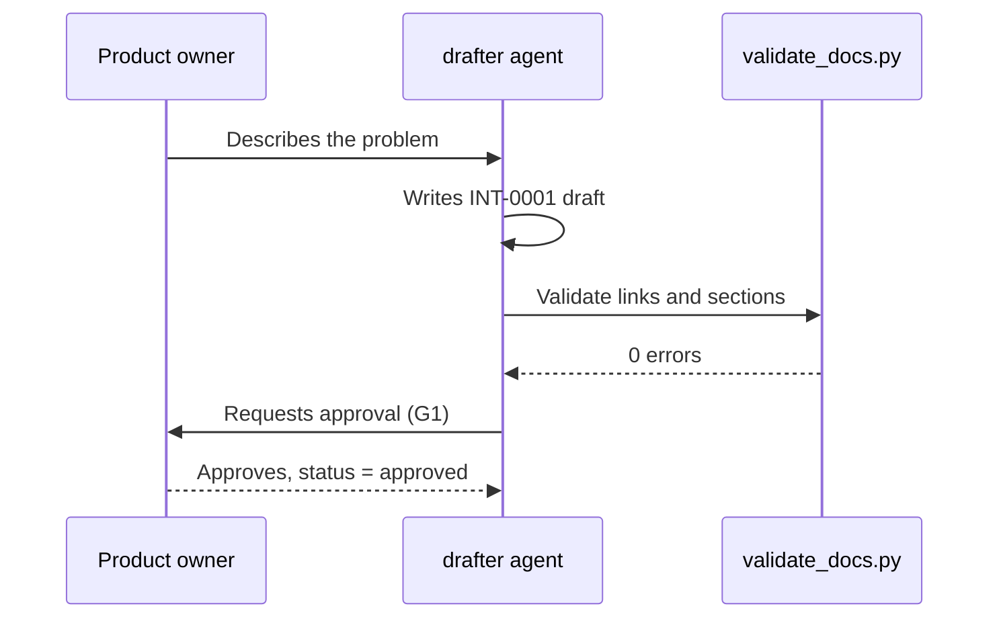

# Diagramming guide (Mermaid)

Rule: whenever you describe or document a process, flow, lifecycle, dependency, state change or interaction, embed a **Mermaid** diagram in the Markdown file itself (a fenced ```` ```mermaid ```` block), never an image or an external file. Text alone hides branches, loops and owners; a diagram lets a reviewer see them at a glance and diff them in git.

A diagram is only useful if it is **descriptive**. Apply the checklist below to every diagram.

## Descriptive checklist
1. **Title and purpose line above the block**: one sentence saying what the diagram shows and the question it answers.
2. **Meaningful labels**: nodes are verbs or states in domain words ("Reviewer approves spec"), never "Step 1" or "Process A".
3. **Label every edge** that is a decision or a condition ("approved", "stale MAJOR", "checks fail").
4. **Show who acts**: use subgraphs or swimlane-style groups for roles (Human, Agent, System).
5. **Show gates, loops and failure paths**, not only the happy path. Mark human approval gates distinctly with a diamond shape and a "Gate" label.
6. **Legend and key** under the block when you use shapes or dashed lines with meaning.
7. **Keep it small**: about 15 nodes maximum. Split into a context view plus detail views.
8. **Link to ids**: use document ids (INT-0001, SPEC-0003) as node labels where a node represents a document.
9. **Text equivalent**: follow the block with 2-4 bullet points narrating the key path, for accessibility and for tools that do not render Mermaid.

## Choosing the diagram type
| You are documenting | Use | Mermaid type |
|---|---|---|
| A process, workflow, decision logic, rollout | Flow with decisions and roles | `flowchart` (TD or LR) |
| Interaction between people, agents and systems over time | Who calls whom, in order | `sequenceDiagram` |
| Lifecycle of a document or object (draft -> approved ...) | States and transitions | `stateDiagram-v2` (or a flowchart with stadium-shaped state nodes) |
| Dependencies and lineage between documents | Directed graph | `flowchart LR` (generated into `.index/graph.mmd`) |
| Schedule, phases, milestones | Timeline of work | `gantt` or `timeline` |
| Data or entity structure | Entities and relations | `erDiagram` |
| Architecture and components | Context and containers | `flowchart` with subgraphs (or `C4Context`) |

## Pattern: process with roles, gates and failure path
Purpose: shows how one stage hands an artifact to the next and where a human must decide.


Key: diamond = human approval gate; arrows are labelled with the outcome.
- The agent drafts and self-checks; the human only decides.
- Rejection loops back to drafting, so rework is visible in the audit trail.

## Pattern: document lifecycle (states as a flowchart)

Key: stadium shapes = document states; `approved` is immutable.
- Only a human moves a document to approved.
- Changing approved content always loops back through review.

## Pattern: interaction over time (sequenceDiagram)


## Theme: use the host default, never override it (mandatory)
Diagrams are rendered by the viewer (GitHub, the Claude app, an IDE) with **its own Mermaid theme**, for example GitHub dark or light. That theme is already tuned for readability in both modes, so the skill never sets its own:

1. **Do not add** `%%{init: ...}%%` headers, `themeVariables`, `classDef`, `class`, `style`, `linkStyle`, `:::class` suffixes or `rect rgb(...)` backgrounds. Custom fills without matching text colours were what made diagrams unreadable.
2. **Convey meaning with shape, position and words, not colour**: a diamond or hexagon for a human gate (and say "Gate G2: ..." in the label), a stadium shape `([...])` for start/end and states, a cylinder `[(...)]` for stored evidence, subgraphs for roles, dashed arrows `-.->` for weak dependencies, and a `Key:` line under the diagram explaining shapes.
3. **Prefer top-down (`TD`) for long chains** (more than about 6 nodes in a row); wide `LR` diagrams shrink until the text is unreadable.
4. **Check it renders**: validate the syntax, and where possible look at it in the target viewer. The validator warns when a diagram overrides the theme.

## Rules for writing the Mermaid itself
- Quote labels that contain punctuation: `A["Approve (G1)"]`.
- Prefer `flowchart` over the legacy `graph` keyword.
- Validate syntax before finishing. If no renderer is available, re-read the block and check each arrow, bracket and quote; the validator also flags unclosed fences and unknown diagram types (`validate_docs.py` diagram check).

## Where diagrams are mandatory in this system
| Document / file | Required diagram |
|---|---|
| intent | Current process vs proposed process (flowchart) when a workflow is affected |
| spec | Design flow or architecture; state diagram if an object has a lifecycle |
| plan | Step flow with dependencies and verification points |
| verification | How checks run and where evidence is stored |
| release | Rollout and rollback path |
| operations | Timeline or sequence of the incident; follow-up decision flow |
| policy | Enforcement flow (skill advises, hook blocks, CI checks) |
| `sdlc/README.md` | Lifecycle loop and gates |
| `.index/graph.mmd` | Generated dependency graph |
Types listed under `diagram_required` in `sdlc.config.json` get a validator **warning** when they have no ```` ```mermaid ```` block. Decisions (DEC) and reviews (REV) only need one if they describe a process.
