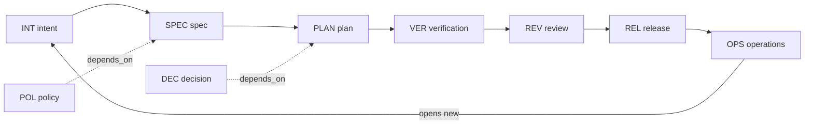

# Linking documents and tracking dependencies

## Principles
1. **Front matter is the source of truth.** Links live in each document's YAML, next to the content they describe. A generated index (`sdlc/.index/graph.json`) is derived and can be rebuilt at any time; never edit it by hand.
2. **Links are pinned.** A link says *which version* the author used. A bare ID cannot show staleness.
3. **Two link kinds, different meaning.**
   - `derived_from`: this document was produced from the upstream one (the stage chain). Exactly the lineage the audit trail needs.
   - `depends_on`: this document relies on another (policy, shared decision, another workstream) but is not produced from it.
4. **One direction only.** Authors write upstream links; downstream and impact views are computed. This avoids two-way link drift.

## Syntax
In front matter, inline lists of `ID@MAJOR.MINOR.PATCH`:
```yaml
derived_from: [INT-0001@1.0.0]
depends_on: [POL-0002@1.1.0, DEC-0004@1.0.0]
supersedes: [SPEC-0001]       # ID only, no version
covers: [R-1, R-2]            # requirement ids from the spec being addressed
```
In the body use relative Markdown links for readers: `[SPEC-0003](../../02-design/specs/SPEC-0003-checkout.md)`. The validator checks that front-matter IDs resolve; it does not require body links, but templates include a "Related documents" section that mirrors the front matter.

## Allowed lineage (default chain)
Purpose: shows which document types may derive from which, and how Maintain feeds the next intent.


Key: solid arrows = `derived_from`; dashed = `depends_on`.
- Lineage flows one way through the stages; OPS is the only way back to INT.
- Policies and decisions can be depended on by any stage.
`config.chain` in `sdlc.config.json` lists the legal `derived_from` type pairs; the validator rejects others (e.g. a PLAN derived directly from an OPS). Edit the config for custom profiles.

## Staleness rules
Compare each pin with the current version of the target:

| Situation | Result | Level |
|---|---|---|
| pin == current | OK | - |
| current has higher MAJOR | **STALE** - downstream built on superseded meaning | error if the downstream is `approved`, else warning |
| current has higher MINOR/PATCH | **DRIFT** | warning |
| target `superseded` / `deprecated` | **DEAD LINK** | error |
| target missing | **BROKEN** | error |
| pin higher than current | **FUTURE** pin (typo or unmerged) | error |

Resolve staleness by re-reading the upstream change, updating the downstream, and updating the pin in the same commit (bump the downstream version accordingly). `scripts/bump.py` lists the downstream documents that will go stale before you commit.

## Integrity checks (all enforced by `validate_docs.py`)
- unique IDs; ID prefix matches `type`; filename starts with ID
- every link resolves; no cycles in `derived_from`/`depends_on`
- non-root types have at least one `derived_from` (orphan check); root types are `intent` and `policy`
- approved documents have `approver`, `approved_on`, and all upstream pins are approved
- changelog newest row == version
- requirements without verification coverage (warning)
- generated outputs: `graph.json` (nodes, edges, staleness), `graph.mmd` (Mermaid), `impact.md` (what each document affects)

## Cross-workstream and cross-repo links
- Workstreams in one repo: same ID space, normal pins.
- Another repo or an external system (Jira, wiki, drive): add an `external_refs: [jira:PROJ-12, url:https://...]` entry. External refs are never validated, only listed, so keep authoritative content in git and mirror it from the external tool, not the reverse.
- Another SDLC repo: reference by `repo:org/name#ID@version`; treat as external ref and re-check manually or with a scheduled job.

## Moving from tickets to artifacts
If a requirements tool already holds the record, make the git document the single narrative and keep the ticket ID in `external_refs`. One source of truth per fact.
